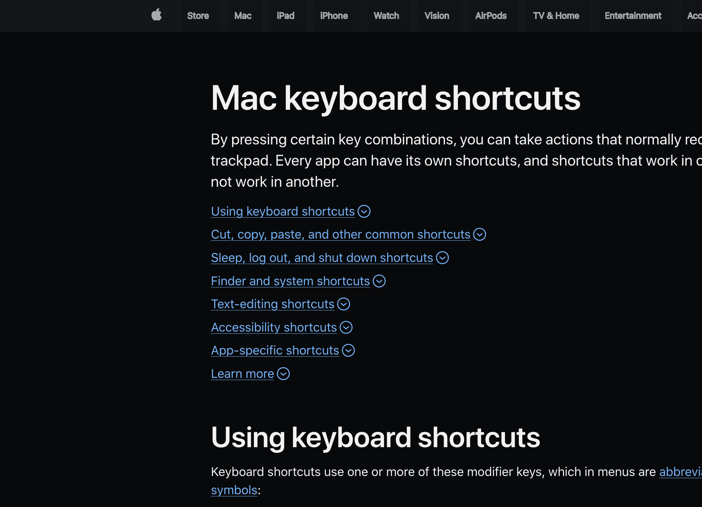
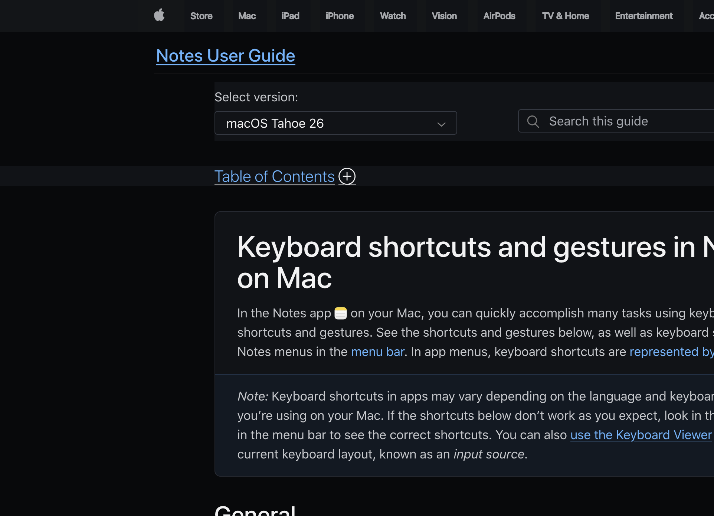

# Apple Support Dark

A CSS-only dark theme for Apple Support articles and guide pages. It is intended for the Stylus browser extension and is scoped to article-like Apple Support URLs instead of the whole `support.apple.com` domain.

This project is unofficial and is not affiliated with Apple.

## Install

1. Install [Stylus](https://github.com/openstyles/stylus) for Firefox, Chrome, or Opera.
2. Open the raw style file:
   [apple-support-dark.user.css](https://raw.githubusercontent.com/dnery/stylus-theme-apple-support/main/apple-support-dark.user.css)
3. Stylus should open its installer page. Click **Install style**.

If the installer does not open, confirm that Stylus is installed and that the URL ends with `.user.css`.

## Supported Pages

The theme targets Apple Support article and guide URL shapes, including:

- `https://support.apple.com/en-us/102650`
- `https://support.apple.com/guide/...`
- `https://support.apple.com/kb/...`
- older `HT...` article URLs

It intentionally does not target the entire Apple Support domain. Search results, community pages, store pages, and unrelated Apple surfaces may keep their original appearance.

## Screenshots

Article page:



Guide page:



## Cybersecurity

This is a CSS-only Stylus theme:

- no JavaScript
- no `@import`
- no remote fonts
- no external images or tracking resources
- no CSS asset loads
- scoped to Apple Support article and guide URLs

The only network URLs in the style metadata are the project homepage, support issue tracker, and update URL used by Stylus.

## Troubleshooting

- If the page stays light, open Stylus and confirm **Apple Support Dark** is enabled for the current page.
- If the style installs but does not update, reinstall it from the raw GitHub URL so Stylus records that source for update checks.
- If a specific article has poor contrast, please open an issue with the URL, a screenshot, and the affected element.

## Development

Run static checks before publishing:

```sh
grep -nEi '@import|javascript:|data:|url\\(|filter' apple-support-dark.user.css
```

That command should return no CSS resource loads or filter-based inversion. Metadata URLs are expected only in the UserCSS header.

## License

MIT. See [LICENSE](LICENSE).
